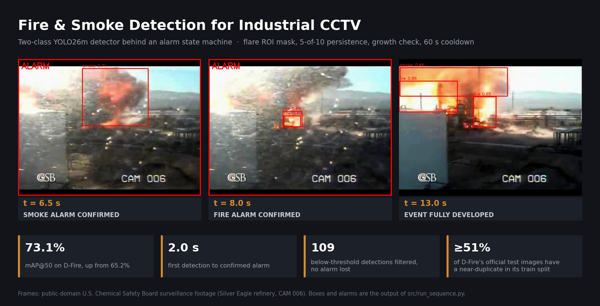
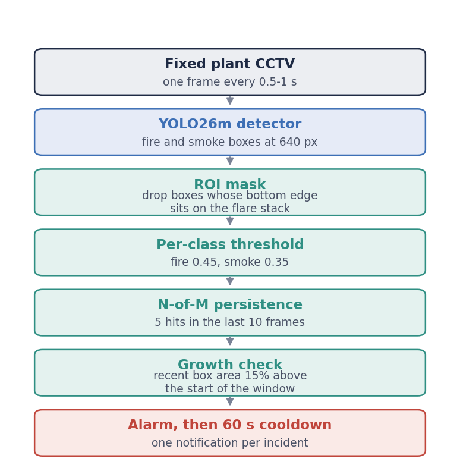
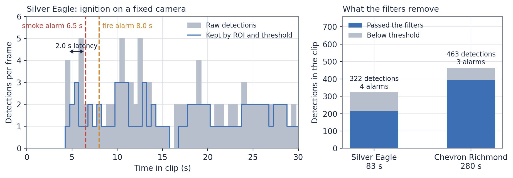
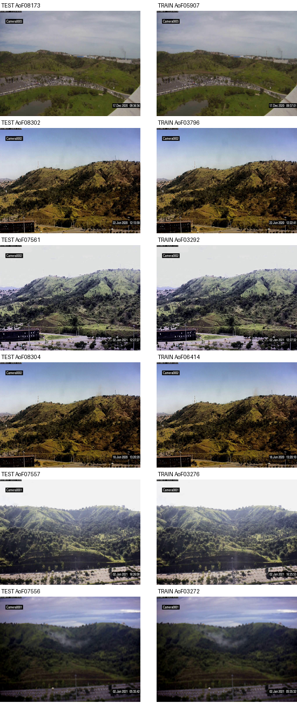

# Industrial Fire & Smoke Detection: YOLO26 + an alarm layer

A two-class (`fire`, `smoke`) detector for fixed plant CCTV, and the deterministic alarm layer behind it that decides when a detection is worth waking someone up for. The detector is the easy half. In a refinery the flare burns around the clock and the stacks vent all day, so a model that alarms on every flame-shaped thing gets switched off in its first week. [`src/alarm.py`](src/alarm.py) is what makes the output usable.



*A fixed surveillance camera at the Silver Eagle refinery during an explosion (public-domain U.S. Chemical Safety Board footage). The boxes, suppressed detections and alarms are the output of [`src/run_sequence.py`](src/run_sequence.py); the per-frame trace is in [results/silver_eagle_trace.csv](results/silver_eagle_trace.csv).*

This is an advisory early-warning prototype, built during a summer internship. It is not a replacement for certified UV/IR flame or gas detectors.

## How an alarm is raised



| Stage | What it does | Why |
|---|---|---|
| ROI mask | Drops detections whose **bottom-centre** sits inside a per-camera polygon (flare tip, vent) | The centroid of a plume rising from a masked flare leaves the mask within seconds; its base doesn't |
| Per-class threshold | `fire` ≥ 0.45, `smoke` ≥ 0.35 | `fire` is both the weaker class (67.8% vs 80.2% recall) and ~69% of all false positives |
| N-of-M | Detected in 5 of the last 10 frames | Kills single-frame flicker |
| Growth check | Mean box area in the last third of the window ≥ 1.15× the first third | A real fire grows; a flare or a steam plume doesn't |
| Cooldown | 60 s per class | One incident, one notification |

The model has no `flare` or `steam` class, so geometry and behaviour carry all of the nuisance rejection. Each camera gets its own config ([`configs/cameras.example.json`](configs/cameras.example.json)), so one noisy camera can be tuned without touching the model or the others. [`tests/test_alarm.py`](tests/test_alarm.py) pins each behaviour down: a steady flare never alarms, flicker never alarms, a masked base is dropped but a plume rising out of the mask is not, and the cooldown holds.

## Results

### The alarm layer on real plant CCTV

Two fixed-camera clips from the CSB archive, run at 2 fps with the 640-px model:

| | Silver Eagle (83 s) | Chevron Richmond (280 s) |
|---|---|---|
| Raw detections | 322 | 463 |
| Below the class threshold, filtered | 109 | 70 |
| First smoke alarm | **6.5 s, 2.0 s after the first kept detection** | 35.5 s |
| First fire alarm | 8.0 s | none |
| Alarms raised | 4 | 3 (all smoke) |



On Chevron, fire detections were too sparse to reach 5-of-10 at the 0.45 threshold, so only smoke alarmed. That fits how the system should be read: **smoke is the early-warning channel, fire is confirmation.**

**What these clips can't show:** a false-alarm rate. CSB films incidents, so every clip has an event in it, including the stretch of Chevron footage I first called "quiet" (it already shows the hydrocarbon release that led to the fire). No normal-operations refinery footage was available, so there is **no false-alarms-per-hour figure** here.

### The detector

YOLO26m, trained at 640 px. Figures as reported by the training platform at the best checkpoint:

| Run | Training data | Image size | mAP@50 | Precision | Recall |
|---|---|---|---|---|---|
| Earlier run | D-Fire **with its 9,838 background images missing** | — | 65.2% | 68.4% | 62.8% |
| **Run 44** | D-Fire | 640 | **73.1%** | **79.1%** | 66.1% |
| Run 46 | D-Fire | 1024 | 73.4% | 76.7% | 67.0% |

Recall from the confusion matrix, i.e. at the confidence threshold you would ship:

| | Run 44 (640) | Run 46 (1024) | Run 58 (+ refinery frames) |
|---|---|---|---|
| Fire recall | 67.8% | 66.4% | 91.7% |
| Smoke recall | 80.2% | 78.7% | 91.0% |
| Macro recall | 74.0% | 72.5% | 91.4% |
| Fire missed as background | 31.9% | 33.3% | 6.5% |

Run 58 added 245 reviewed refinery frames, and I hand-corrected annotations across D-Fire and the other sets before training it. **It was scored after that cleaning, so it isn't measured on the same basis as runs 44 and 46.** Its macro recall rose 17 points while mAP@50 only moved 73.1% → 73.4%. A confusion matrix is taken at one threshold and mAP integrates over all of them, so the two can diverge, but a gap this size should be re-checked on a fixed split before anyone relies on it. Runs 44 and 46 are the clean comparison.

All D-Fire numbers here, like every published D-Fire number, carry the test-split problem described next.

## What went wrong, and how I found it

**1. 46% of the dataset disappeared on import, silently.**
The first full run scored 65.2% mAP with weak precision. Counting the platform's export against what I had uploaded showed that **every one of D-Fire's 9,838 background images was gone**: 21,527 uploaded, 11,689 exported, and 21,527 − 9,838 = 11,689 exactly. The importer treated an empty label file as "not annotated yet" and parked those images in a queue the export skips. Those are the sunsets, streetlights and glare off steel that teach the model *not* to fire. [`data/pack_dfire_negatives.py`](data/pack_dfire_negatives.py) repacks exactly the missing set and refuses to write if the leftover set isn't exactly the background set. The rerun (run 44) also changed the training schedule (150 epochs, batch 16, 640 px), so the 65.2% → 73.1% gain comes from both changes together.

**2. D-Fire's own splits leak, and the official test split is the worst.**
Most of D-Fire is video-derived. Building a validation split, I found its published 5-fold split has a visually near-identical copy (dHash ≤ 10) of **~40%** of each validation fold in the training fold. So [`data/split_dfire_val.py`](data/split_dfire_val.py) groups consecutive near-identical frames into shots and assigns whole shots ([`data/splits/`](data/splits/)). I then audited the official train/test split, which is the one papers report on. **At least 51% of the 4,306 test images have a near-duplicate in train.** The number holds against a control set from an unrelated dataset (28.8% floor from dHash collisions alone) and a pixel-level check on 800 flagged pairs.



*Left: official test images. Right: their nearest official training images. Same camera, and the burned-in clocks are 5–15 s apart.*

The split looks careful: each filename prefix is cut as one contiguous block. It fails because the index order isn't chronological, so frames from one camera event are scattered across the whole range. Full audit, controls and per-source breakdown: [docs/dfire_test_leakage.md](docs/dfire_test_leakage.md).

**3. I predicted resolution would be the biggest lever. It wasn't.**
44.66% of the objects are "tiny" after downscaling, so I expected 1024 px to beat 640. It gave +0.3 mAP (noise), was slightly worse in every confusion-matrix cell, and cost about 5× the GPU time. Everything stayed at 640, and the choice is now based on a measurement rather than an assumption.

**4. Two datasets, same two classes, opposite indices.**
D-Fire is `0 = smoke, 1 = fire`. FASDD and the trained model are `0 = fire, 1 = smoke`. Mixing them raises no error: the files parse, both classes exist, and every box has swapped class. I proved D-Fire's order from its published category counts ([`data/README.md`](data/README.md)), and every packing script remaps to one order and writes it into `data.yaml`.

## Repository layout

```
src/        detector.py: thin YOLO wrapper, returns Detection objects
            alarm.py: ROI mask, per-class threshold, N-of-M, growth check, cooldown
            run_sequence.py: detector + alarm over a frame folder or video; trace CSV, annotated frames
tests/      test_alarm.py: alarm behaviour on synthetic detections (no model needed)
configs/    cameras.example.json: per-camera masks and thresholds
data/       fetch, verify, split and audit scripts (see data/README.md)
data/splits/  D-Fire official split + our leakage-free train/val split
results/    per-frame traces and frame manifests for the two CCTV clips
docs/       figures (make_figures.py rebuilds them from results/), D-Fire leakage audit
```

## Setup

```bash
# PyTorch for your CUDA version first: https://pytorch.org/get-started/locally/
pip install -r requirements.txt
python -m pytest tests
```

**Run the detector + alarm layer on a video or frame folder**
```bash
python src/run_sequence.py path/to/video.mp4 --weights path/to/best.pt --fps 25 \
    --cameras configs/cameras.example.json --camera-id tank_farm_cam3 \
    --csv out/trace.csv --annotate out/frames
```
`--fps` is the playback rate of the source, so the cooldown is in seconds rather than frames. The run prints each alarm and how many detections were filtered.

### Reproducing the Silver Eagle trace

```bash
python data/fetch_csb.py --refinery-only
python data/extract_frames.py "data/raw/csb/videos/Silver Eagle Refinery Explosion Surveillance Footage [yDmuaR6rkgU].mp4" \
    --start 20 --end 103 --fps 2
python src/run_sequence.py data/raw/csb/frames/yDmuaR6rkgU --weights path/to/best.pt --fps 2 --csv out/silver_eagle.csv
```

With ultralytics 8.4.37 and opencv 4.9 this reproduces [results/silver_eagle_trace.csv](results/silver_eagle_trace.csv) byte for byte. Ultralytics 8.4.150 shifts confidences by a few hundredths: the smoke alarm still fires at 6.5 s, but the first fire alarm moves to 9.5 s and 91 detections are filtered instead of 109. That's why `requirements.txt` pins the version.

## Weights

Not distributed. The code, configs, splits and traces are all here, and D-Fire is CC0, so the D-Fire-only baseline can be retrained from scratch.

## Limitations

- No false-alarm rate (see above). RISE was downloaded for this, but its clips are 180×180 and its "positives" are routine stack emissions, so it needs a held-out-view split and a decision on what counts as a false alarm first.
- The growth check follows the largest box of each class per frame, not identities. That holds while one event is in view; two simultaneous fires in one frame would need real tracking.
- Only two fixed-camera clips. Most refinery footage in the archive is news or handheld video.

## Stack

PyTorch · Ultralytics YOLO26 · OpenCV · NumPy · dHash near-duplicate auditing · RapidOCR · Matplotlib

## Credits

- D-Fire: Pedro Vinícius A. B. de Venâncio et al., [github.com/gaiasd/DFireDataset](https://github.com/gaiasd/DFireDataset), CC0 1.0.
- FASDD: Wang et al., [ScienceDB](https://doi.org/10.57760/sciencedb.j00104.00103), CC BY 4.0.
- RISE: Hsu et al., CMU CREATE Lab, [deep-smoke-machine](https://github.com/CMU-CREATE-Lab/deep-smoke-machine), CC0.
- U.S. Chemical Safety Board video archive, [archive.org](https://archive.org/details/uscsb-video-archive-september-2025), public domain. Frames shown above.
- [Ultralytics](https://github.com/ultralytics/ultralytics) (AGPL-3.0) is an installed dependency. This repo's own code is MIT.
